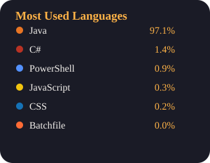

  

  <h2>👋 Привет, я Fonisha</h2>

  
  

   
   

  
  
  
  
  
  

## 📊 Статистика

  
  

## 🧩 Обо мне

Люблю разбираться, как всё устроено, и пробовать новое на практике. Здесь собираю свои проекты и идеи.

## 🐍 Змейка

  

   

  

    
  

  
<i>“I find motivation in every step.”</i>

